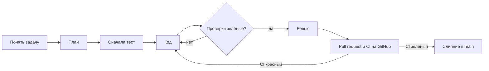

# Пупульта Town: рабочая среда для ИИ

> Перенесено из документа на claude.ai 27 октября 2026. Дальше основная версия — этот файл: правки вносятся через pull request.

Шаг 3 плана. Опирается на [концепцию](concept.md) и [архитектуру и стек](architecture.md).

## Итог

Сначала неудобная правда. Облачные треды этого проекта Claude берут из репозитория только CLAUDE.md и правила. Скиллы, субагентов, `.mcp.json` и хуки они не загружают \[Certain, [документация Claude Code](https://code.claude.com/docs/en/claude-projects#what-threads-pick-up-from-your-repositories)\]. Поэтому среда строится в три слоя:

1. **Правила в файлах, которые читают все.** AGENTS.md и CLAUDE.md работают и у Claude, и у ChatGPT, и в облаке.
2. **Инструменты отдельно для каждого места запуска.** Одни и те же MCP-серверы и скиллы подключаются три раза: файлами для Claude Code, файлами для Codex и настройками аккаунта для облачных тредов.
3. **CI на GitHub как единственная проверка, которую нельзя обойти.** Хуки срабатывают только на компьютере, а CI проверяет каждый pull request, кто бы его ни написал.

| Что | Где лежит | Claude Code на компьютере | Облачный тред проекта | ChatGPT / Codex |
| --- | --- | --- | --- | --- |
| Общие правила | `AGENTS.md` | да, через импорт в CLAUDE.md | да | да |
| Особенности Claude | `CLAUDE.md` | да | да | нет |
| Субагенты ревьюер и тестировщик | `.claude/agents/` | да | нет, только правила в AGENTS.md | нет, только правила в AGENTS.md |
| Хуки «проверь после правки» | `.claude/settings.json` | да | нет | нет |
| MCP-серверы | `.mcp.json`, `.codex/config.toml`, коннекторы claude.ai | `.mcp.json` | коннекторы аккаунта | `.codex/config.toml` |
| Скиллы | `.agents/skills/` и копия в `.claude/skills/` | да | нет, включаются в аккаунте или плагином проекта | да |
| CI | `.github/workflows/ci.yml` | общий для всех | общий для всех | общий для всех |

Черновики всех этих файлов я пишу сейчас и кладу в репозиторий первым pull request, как только он появится.

## Структура репозитория

Один монорепозиторий на pnpm, как решили на шаге 2. Папки приложения появятся с первым срезом, а файлы для ИИ и CI кладём сразу.

```text
pupulta-town/
├── AGENTS.md               общие правила для всех ИИ
├── CLAUDE.md               @AGENTS.md + особенности Claude Code
├── .mcp.json               MCP-серверы для Claude Code
├── .codex/config.toml      MCP-серверы для ChatGPT и Codex
├── .agents/skills/         скиллы проекта, источник (читает Codex)
├── .claude/
│   ├── settings.json       хуки и разрешения
│   ├── hooks/              скрипты хуков
│   ├── agents/             reviewer.md, tester.md
│   └── skills/             копия .agents/skills (читает Claude Code)
├── .github/workflows/ci.yml
├── apps/web/               клиент: React + React Three Fiber
├── packages/sim/           симуляция города, без 3D
├── packages/shared/        общие типы и константы
├── supabase/               migrations/ и tests/ (тесты прав доступа)
├── assets/                 .glb из Blender
├── scripts/                проверка ассетов, синхронизация скиллов
└── docs/                   концепция, архитектура, решения, планы
```

Почему так:

- **Скиллы в двух папках.** Codex ищет скиллы в `.agents/skills` \[Certain, [ChatGPT Learn](https://learn.chatgpt.com/docs/build-skills)\], Claude Code в `.claude/skills` \[Certain, [документация](https://code.claude.com/docs/en/skills)\]. Формат у обоих один, открытый стандарт Agent Skills. Источник держим в `.agents/skills`, а скрипт копирует его в `.claude/skills`, и CI падает, если копии разошлись. Символьные ссылки проще, но на Windows Git часто выкачивает их как обычные текстовые файлы \[Certain, [документация Claude Code](https://code.claude.com/docs/en/memory#share-one-file-with-other-coding-tools)\].
- **Симуляция отдельным пакетом.** Это решение шага 2. Запрет импортировать в `packages/sim` что-то из three или React проверяет линтер, а не память агента.
- **Решения в `docs/decisions/`.** Каждое важное решение (стек, Supabase, два трекера) — короткий файл: что решили и почему. ИИ читает их и не пересматривает решённое.
- **Концепция и архитектура переезжают в `docs/`** копией в Markdown. Иначе агент в репозитории их не увидит.

## AGENTS.md и CLAUDE.md

Один файл правил на всех, как договорились. Работает это так:

- **Codex** читает AGENTS.md от корня репозитория вниз до текущей папки и обрезает инструкции на 32 КиБ \[Certain, [ChatGPT Learn](https://learn.chatgpt.com/docs/agent-configuration/agents-md)\]. Черновик занимает 7,5 КБ, запас есть.
- **Claude Code** сам читает AGENTS.md, только когда в проекте нет CLAUDE.md. У нас CLAUDE.md будет, поэтому его первая строка — импорт `@AGENTS.md`. Дважды файл при этом не читается \[Certain, [документация Claude Code](https://code.claude.com/docs/en/memory#share-one-file-with-other-coding-tools)\].
- **Облачные треды** загружают CLAUDE.md из корня репозитория, а с ним и импорт \[Likely: импорты раскрываются при загрузке CLAUDE.md, но отдельно для тредов это не описано; проверю первым же тредом в репозитории\].

Что в черновике AGENTS.md:

| Раздел | Что в нём |
| --- | --- |
| Проект | суть игры в пяти строках и ссылки на концепцию, архитектуру и решения; решённое не пересматривать без просьбы человека |
| Стек | пакеты монорепозитория и что в каждом |
| Команды | `pnpm verify` и остальные; появятся с первым срезом |
| Цикл работы | семь шагов от «пойми задачу» до pull request, см. следующий раздел |
| Инварианты | семь правил, нарушение которых — ошибка даже при зелёных тестах: симуляция без 3D и без случайности вне seed, права в базе, порча вычисляется, не больше 20 участников, требования к .glb |
| Тесты | что чем тестируем; запрет на отключение и ослабление тестов |
| База данных | только новые миграции; MCP Supabase только к dev-проекту и только на чтение |
| Git и язык | ветка на задачу, без пушей в main; код и коммиты по-английски, документация и PR по-русски |
| Code Review Rules | чек-лист ревью. Раздел с таким заголовком читает и ревью Codex на GitHub \[Certain, [ChatGPT Learn](https://learn.chatgpt.com/docs/agent-configuration/agents-md)\] |

CLAUDE.md короткий: импорт, три правила только для Claude (субагенты, Context7, план перед большой задачей) и что делать в облачном треде, где субагентов и хуков нет.

Язык кода и коммитов — мой выбор по умолчанию, его легко поменять одной строкой. Оба файла лежат в корне репозитория.

## Цикл работы



Это тот самый цикл «продумать, план, код, тесты до зелёного», записанный в AGENTS.md. Тест идёт до кода, чтобы ИИ не писал тесты, которые подтверждают уже написанное. Кто проверяет «Проверки зелёные?», зависит от того, где работает агент:

- **Claude Code на компьютере.** Хук Stop запускает `pnpm verify` перед каждым окончанием работы. Красный результат возвращает Claude к работе с текстом ошибки. Чтобы не крутиться вечно, Claude Code сам останавливается после 8 таких возвратов подряд \[Certain, [документация хуков](https://code.claude.com/docs/en/hooks)\]. Второй хук после каждой правки файла гоняет линтер по этому файлу.
- **Облачный тред и ChatGPT.** Хуков нет, `pnpm verify` агент запускает по правилу из AGENTS.md. Это слабее: правило можно забыть \[Likely\].
- **Pull request.** CI на GitHub проверяет всех одинаково: Claude, ChatGPT и людей.

Хуки я проверил на тестовом репозитории. Красный `pnpm verify` блокирует окончание работы, зелёный пропускает. Зелёный результат запоминается, и без новых изменений проверки не гоняются повторно. Пока в репозитории нет `package.json`, оба хука ничего не делают.

## Роли

Начинаем с одного основного агента и двух субагентов, как договорились.

| Роль | Кто | Что делает | Где работает |
| --- | --- | --- | --- |
| Основной агент | Claude Code или Codex | ведёт цикл, пишет план и код, зовёт помощников | везде |
| Ревьюер | субагент `reviewer` | сверяет изменения с AGENTS.md, запускает `pnpm verify`, отвечает списками «Блокеры», «Стоит исправить», «Можно лучше»; файлы не меняет | Claude Code на компьютере |
| Тестировщик | субагент `tester` | пишет недостающие тесты, право на правку только у файлов тестов | Claude Code на компьютере |
| Руководитель | вы, люди | утверждаете план больших задач и сливаете pull request | — |

Как это устроено:

- Субагенты — файлы в `.claude/agents/` с именем, описанием и списком инструментов \[Certain, [документация](https://code.claude.com/docs/en/sub-agents)\]. Ревьюеру даны только чтение, поиск и командная строка.
- Запрет тестировщику править что-то кроме тестов — хук в его файле, а не просьба словами. Я проверил скрипт: правку `a.ts` он блокирует, `a.test.ts` пропускает. Работает хук, только когда папке проекта доверили в Claude Code \[Certain, та же документация\].
- В облачных тредах и в Codex этих субагентов нет. Там основной агент проходит чек-лист «Code Review Rules» сам.

Когда добавлять остальных:

- **Агент-руководитель отдельно не нужен.** Скилл Superpowers уже умеет раздавать задачи плана субагентам и проверять их работу \[Certain, [README Superpowers](https://github.com/obra/superpowers)\]. Свой дирижёр дублировал бы его.
- **Дизайнер** — когда начнём интерфейс трекера и появится мудборд. Скорее всего это будет скилл с правилами стиля, а не субагент \[Guessing\].
- **Новая роль появляется, когда одна и та же ошибка повторяется.** Раньше она только тратит токены.

## MCP-серверы

Три сервера, каждый закрывает конкретную дыру. Больше не ставим: каждый лишний сервер — это инструкции в контексте и лишний доступ \[Likely\].

| Сервер | Зачем | Права и риски | В облачном треде |
| --- | --- | --- | --- |
| Context7 | свежая документация three, React Three Fiber, Supabase, Colyseus, чтобы ИИ не путал API | только чтение документации. Ключ не обязателен, бесплатный даёт больше запросов \[Certain, [README](https://github.com/upstash/context7)\] | уже подключён к аккаунту |
| Supabase | схема, логи и советы по безопасности dev-проекта | только dev-проект (`project_ref`), только чтение (`read_only=true`), часть групп инструментов. Главный риск — подмена инструкций через данные в базе \[Certain, [документация Supabase](https://supabase.com/docs/guides/ai-tools/mcp)\] | подключён к аккаунту, но без этих ограничений, см. ниже |
| Playwright | агент сам открывает приложение в браузере, нажимает кнопки и читает страницу | браузер без окна и без сохранённого профиля (`--headless --isolated`) \[Certain, [README](https://github.com/microsoft/playwright-mcp)\] | уже есть плагином |

Одни и те же серверы описаны дважды: в `.mcp.json` для Claude Code \[Certain, [документация](https://code.claude.com/docs/en/mcp)\] и в `.codex/config.toml` для ChatGPT и Codex. Второй файл Codex читает только в проекте, которому доверили, и один конфиг общий у приложения ChatGPT, Codex CLI и расширения IDE \[Certain, [ChatGPT Learn](https://learn.chatgpt.com/docs/extend/mcp)\].

Два решения про безопасность:

- **Агент не меняет удалённую базу через MCP.** Миграции идут файлами через git и CI, а в удалённый проект их отправляет человек. Команда `supabase db push` агенту запрещена в `.claude/settings.json`.
- **Коннектор Supabase на аккаунте claude.ai видит все ваши проекты Supabase.** \[Likely: у него есть инструменты list\_projects и create\_project.\] Пока там нет настоящих данных, это не проблема. Когда появится production, его стоит держать в отдельной организации Supabase, куда коннектор не подключён \[Guessing: как именно коннектор ограничивает доступ, я не проверял\].

GitHub-сервер не ставим: агент на компьютере работает через git и `gh`, а у облачных тредов GitHub встроен.

### Blender

Добавлено 28 октября 2026, сравнение вариантов — в документе [«ИИ и Blender: MCP-серверы и скиллы»](https://claude.ai/artifact/29sZ4eGRsw7iB11gDd1sMN).

Ставим официальный сервер Blender Lab. Он бесплатный (GPL-3.0), требует Blender 5.1 или новее \[Certain, [blender.org](https://www.blender.org/lab/mcp-server/)\], а у нас обоих 5.2.3 LTS. Этот же сервер Anthropic называет коннектором Blender для Claude \[Certain, [anthropic.com](https://www.anthropic.com/news/claude-for-creative-work)\]. Он даёт ИИ сводку сцены, скриншоты, выполнение Python в открытом Blender и поиск по документации Python API и руководству.

Модели рисуем сами, поэтому ИИ в Blender нужен для проверок и рутины: имена узлов `stage_*`/`decay_*`/`tint_*`, опора, габариты кратно клетке, подсчёт полигонов, пакетный экспорт \[Likely\].

Главный риск: сервер выполняет код от ИИ без защиты. Blender Lab сам советует виртуальную машину или компьютер без важных данных \[Certain, [blender.org](https://www.blender.org/lab/mcp-server/)\]. Поэтому:

- вызовы инструментов Blender подтверждать вручную и не добавлять их в разрешённые;
- держать `.blend` под git, чтобы откатить испорченный файл;
- не открывать с подключённым ИИ чужие `.blend`: имена объектов в них могут содержать инструкции для ИИ \[Guessing\].

В `.mcp.json` и `.codex/config.toml` сервер **не кладём**: он работает только при запущенном Blender у того, кто его поставил. Каждый ставит сам:

1. Добавить в Blender дополнение: перетащить в окно Blender ссылку «Drag and Drop» со [страницы сервера](https://www.blender.org/lab/mcp-server/#addon) дважды (первый раз добавляется репозиторий Blender Lab, второй — само дополнение).
2. Поставить [uv](https://docs.astral.sh/uv/) и скачать сервер: `git clone https://projects.blender.org/lab/blender_mcp.git` в удобную папку \[Certain, [инструкция](https://projects.blender.org/lab/blender_mcp/wiki/Setup)\].
3. Подключить к агенту, указав путь к папке `mcp` внутри скачанного:
   - Claude Code: `claude mcp add --transport stdio --scope user blender -- uv --directory <путь>/blender_mcp/mcp run blender-mcp` \[Certain: синтаксис из [документации](https://code.claude.com/docs/en/mcp)\]
   - Codex: в личный `~/.codex/config.toml` раздел `[mcp_servers.blender]` с `command = "uv"` и `args = ["--directory", "<путь>/blender_mcp/mcp", "run", "blender-mcp"]`.
4. Открыть Blender и спросить агента: «Сколько объектов в открытой сцене?»

Blender из Steam обновляется сам, когда выходит новая версия \[Likely: Steam ставит последний выпуск, а другие версии выбираются во вкладке Betas — [документация Blender](https://developer.blender.org/docs/handbook/release_process/stores/steam/)\]. Чтобы у обоих была одна версия, выберите в Steam ветку 5.2 LTS: Библиотека → Blender → Свойства → Бета-версии.

В облачных тредах проекта Blender недоступен: облако не видит Blender на вашем компьютере.

## Скиллы

Скилл — папка с файлом SKILL.md. Агент сначала видит только его имя и описание и загружает целиком, когда задача подходит \[Certain, [Claude Code](https://code.claude.com/docs/en/skills), [ChatGPT Learn](https://learn.chatgpt.com/docs/build-skills)\]. Поэтому в скиллы уходит то, что нужно иногда, а в AGENTS.md остаётся то, что нужно всегда.

| Скилл | Что даёт | Как поставить |
| --- | --- | --- |
| Superpowers | готовая методика нашего цикла: уточнить задачу, написать план, сначала тест, искать причину бага, не объявлять «готово» без проверки, раздать задачи субагентам \[Certain, [README](https://github.com/obra/superpowers)\] | Claude Code: `/plugin install superpowers@claude-plugins-official`. Приложение Codex: раздел Plugins. Облачные треды: уже подключён в этом проекте |
| Supabase Agent Skills | два скилла: весь Supabase с RLS и CLI, и лучшие практики Postgres \[Certain, [README](https://github.com/supabase/agent-skills)\] | `npx skills add supabase/agent-skills`, или плагином Claude Code из того же репозитория |
| db-change, свой | миграция, политика RLS и тест pgTAP одной последовательностью; правила проекта для базы | лежит в репозитории |
| glb-asset, свой | требования к модели из Blender, проверка и сжатие через gltf-transform \[Certain, команды из [документации](https://gltf-transform.dev/cli)\] | лежит в репозитории |

Риск Superpowers: перед работой он расспрашивает человека, что тот на самом деле хочет \[Certain, README\]. На мелких задачах это может тормозить \[Guessing\]. Если так и окажется, впишем в AGENTS.md, для каких задач расспрос не нужен.

Свои скиллы лежат в `.agents/skills`, скрипт копирует их в `.claude/skills`, и скрипт я проверил. В облачных тредах скиллы из репозитория не грузятся, их нужно включить в аккаунте \[Certain, [документация](https://code.claude.com/docs/en/claude-projects#get-skills-plugins-connectors-and-tools-into-threads)\]. Когда одобрите черновики, я предложу добавить их в аккаунт карточкой. Скиллы про симуляцию и сцену напишем вместе с первым срезом, когда будет что описывать.

## CI и защита ветки

Сначала неудобное. Запретить слияние при красном CI можно только защитой ветки. Бесплатно она есть только у публичных репозиториев, для приватного нужен платный GitHub Pro или Team \[Certain, [документация GitHub](https://docs.github.com/en/repositories/configuring-branches-and-merges-in-your-repository/managing-protected-branches/about-protected-branches)\]. В приватном репозитории на бесплатном тарифе «не сливать красное» останется правилом на словах.

Что делает черновик `.github/workflows/ci.yml`:

| Задача | Что проверяет | Когда включается |
| --- | --- | --- |
| detect | есть ли уже приложение и база | всегда |
| skills | копии скиллов для Claude и Codex совпадают | всегда |
| check | типы, линтер, Vitest, проверка ассетов | когда появится `package.json` |
| db | поднимает Supabase внутри CI и гоняет тесты pgTAP \[Certain, [документация Supabase](https://supabase.com/docs/guides/local-development/testing/overview)\] | когда появится `supabase/config.toml` |
| e2e | Playwright в Chromium, отчёт при падении | после зелёного check |

Пропущенная задача считается пройденной для обязательных проверок \[Certain, та же документация GitHub\]. Поэтому все пять можно сделать обязательными с первого дня, и они включатся сами по мере появления кода. Версии действий GitHub взяты свежие, по страницам релизов на 27 октября: checkout v7, setup-node v7, pnpm/action-setup v6, supabase/setup-cli v3, upload-artifact v7.

Ревью от ИИ прямо в pull request ставить не спешу. Действие Claude Code отвечает на `@claude` в PR, но требует ключ API или токен подписки в секретах репозитория \[Certain, [документация](https://code.claude.com/docs/en/github-actions)\]. У Codex есть своё ревью на GitHub, оно читает раздел «Code Review Rules» из AGENTS.md; как его включить, я не проверял. Вернёмся к этому, когда pull request пойдут потоком.

## Как работает товарищ через ChatGPT

Читает ли AGENTS.md режим Work, я не могу подтвердить: документация описывает только Codex. Поэтому для кода ему нужен вид Codex в приложении ChatGPT. Настройка на его стороне:

1. Открыть репозиторий в Codex. AGENTS.md он прочитает сам, до начала работы \[Certain, [ChatGPT Learn](https://learn.chatgpt.com/docs/agent-configuration/agents-md)\].
2. Пометить проект как доверенный. Иначе Codex не подхватит MCP-серверы из `.codex/config.toml` \[Certain, [ChatGPT Learn](https://learn.chatgpt.com/docs/extend/mcp)\].
3. Поставить Superpowers из раздела Plugins \[Certain, [README](https://github.com/obra/superpowers)\]. Скиллы проекта из `.agents/skills` Codex найдёт сам.
4. Проверить: попросить Codex пересказать текущие инструкции. Этот способ проверки советует сама документация.

Чем его среда слабее: субагентов и хуков из репозитория у него нет. Проверки Codex запускает по правилу из AGENTS.md, а то, что он пропустит, ловит CI.

Чтобы два ИИ не мешали друг другу:

- Одна задача — одна ветка — один pull request. В одной ветке одновременно работает кто-то один.
- Каждое решение, принятое в разговоре с одним ИИ, записывается в `docs/decisions/`. Иначе другой ИИ о нём не узнает.
- Правила меняются только в AGENTS.md, а не в личных настройках ChatGPT или Claude.

## Что нужно от вас

Сейчас:

1. ~~Решить, публичный репозиторий или приватный.~~ Решено 27 октября: публичный, см. `docs/decisions/0005-public-repository.md`.
2. ~~Создать репозиторий на GitHub.~~ Создан `MeGuRu11/Pupulta-Town` и добавлен в проект на claude.ai.
3. **Включить защиту ветки `main`** после первого прогона CI, шаги в `docs/decisions/0005-public-repository.md`.
4. **Товарищу** — четыре шага из раздела выше.

Позже, с первым срезом:

- Создать бесплатный dev-проект Supabase и прислать его id. На компьютере он задаётся переменной `SUPABASE_DEV_PROJECT_REF`, у товарища вписывается в `.codex/config.toml`.
- Для работы на компьютере нужен Docker: без него не поднимется локальная база для тестов \[Likely\].
- По желанию — бесплатный ключ Context7 для большего числа запросов.

## Источники

Все открыты 27 октября 2026.

- Claude Code: [CLAUDE.md, AGENTS.md и импорты](https://code.claude.com/docs/en/memory), [что загружают облачные треды проекта](https://code.claude.com/docs/en/claude-projects#what-threads-pick-up-from-your-repositories), [субагенты](https://code.claude.com/docs/en/sub-agents), [хуки](https://code.claude.com/docs/en/hooks), [скиллы](https://code.claude.com/docs/en/skills), [MCP](https://code.claude.com/docs/en/mcp), [разрешения](https://code.claude.com/docs/en/permissions), [GitHub Actions](https://code.claude.com/docs/en/github-actions)
- ChatGPT и Codex: [AGENTS.md](https://learn.chatgpt.com/docs/agent-configuration/agents-md), [скиллы](https://learn.chatgpt.com/docs/build-skills), [MCP](https://learn.chatgpt.com/docs/extend/mcp)
- Supabase: [MCP-сервер](https://supabase.com/docs/guides/ai-tools/mcp), [тесты pgTAP и CI](https://supabase.com/docs/guides/local-development/testing/overview), [Agent Skills](https://github.com/supabase/agent-skills)
- GitHub: [защищённые ветки](https://docs.github.com/en/repositories/configuring-branches-and-merges-in-your-repository/managing-protected-branches/about-protected-branches); страницы релизов [actions/checkout](https://github.com/actions/checkout/releases), [actions/setup-node](https://github.com/actions/setup-node/releases), [pnpm/action-setup](https://github.com/pnpm/action-setup/releases), [supabase/setup-cli](https://github.com/supabase/setup-cli/releases), [actions/upload-artifact](https://github.com/actions/upload-artifact/releases)
- MCP и скиллы: [Context7](https://github.com/upstash/context7), [Playwright MCP](https://github.com/microsoft/playwright-mcp), [Superpowers](https://github.com/obra/superpowers)
- Ассеты: [glTF Transform CLI](https://gltf-transform.dev/cli)
