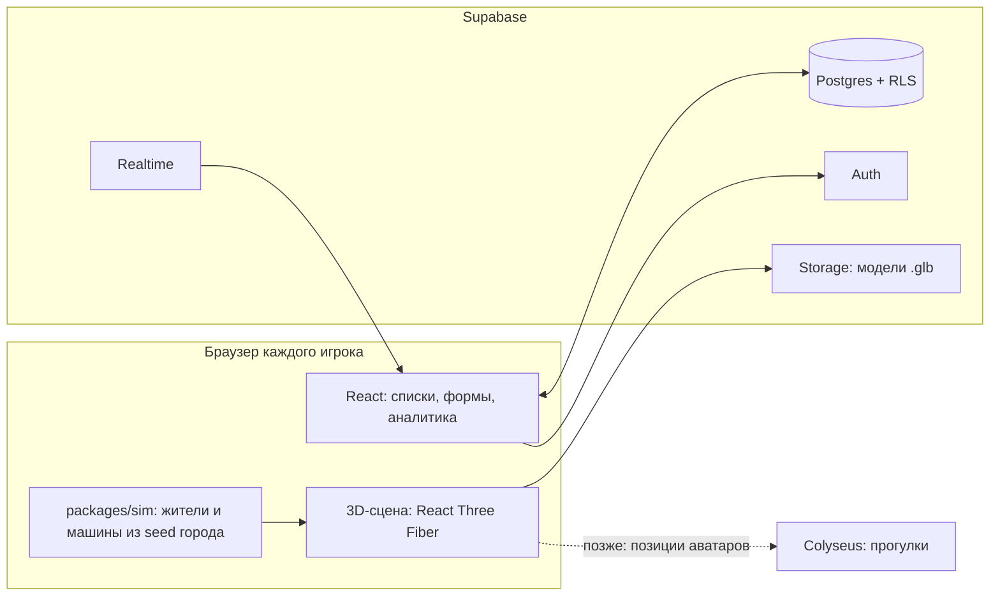

# Пупульта Town: архитектура и стек

> Перенесено из документа на claude.ai 27 октября 2026. Дальше основная версия — этот файл: правки вносятся через pull request.

Шаг 2 плана. Опирается на [концепцию (GDD)](concept.md) и решения от 27 октября.

## Итог

Рекомендация: TypeScript везде, клиент на React и React Three Fiber (Three.js), сервер на Supabase. Отдельный сервер для прогулок аватаров (Colyseus) добавим, когда дойдём до этой функции. 3D-движок утверждаем окончательно только после прототипа толпы жителей (раздел «Риски и прототипы»).

| Слой | Выбор | Почему |
| --- | --- | --- |
| Язык | TypeScript | один язык на клиенте и сервере; типы ловят ошибки ИИ до запуска \[Likely\] |
| Интерфейс трекера | React + Vite | списки, формы и аналитику проще делать в HTML поверх сцены, чем внутри 3D |
| 3D-сцена | Three.js через React Three Fiber | самая большая экосистема; сцена описывается React-компонентами и сама обновляется от данных задач |
| Данные, вход, файлы | Supabase: Postgres, Auth, Storage | всё в одном месте, права доступа прямо в базе, бесплатный тариф покрывает старт |
| Обновления в реальном времени | Supabase Realtime | изменения задач и список тех, кто сейчас в городе |
| Прогулки аватаров (позже) | Colyseus на своём сервере | бесплатного лимита сообщений Supabase для этого не хватит, расчёт в разделе «Сервер» |
| Тесты | Vitest, Playwright | модульные и браузерные тесты, скриншоты 3D-сцены |
| Репозиторий | монорепозиторий на pnpm | клиент, симуляция города, общие типы и миграции базы в одном месте |

Главное архитектурное решение: фоновая жизнь города живёт в отдельном пакете без 3D и считается из «зерна» (seed) города. Так её можно тестировать без браузера, а смена 3D-движка не затронет логику \[Likely\].

## Как устроена система

По сети идут только задачи, роли, очки и модели. Жителей и машины каждый браузер считает сам, а пунктирная связь с Colyseus появится вместе с прогулками аватаров.

## 3D в браузере

Рекомендация: Three.js через React Three Fiber, запасной вариант Babylon.js. Решающий фактор — размер экосистемы: three скачивают примерно в 66 раз чаще, чем Babylon.js (20 739 523 / 312 000 ≈ 66). \[Likely\] Чем больше кода и примеров на библиотеке, тем точнее её использует ИИ, а здесь весь код пишет ИИ.

| Движок | Скачиваний npm, 20–26 окт. 2026 | Текущая версия | Сильные стороны | Слабые стороны |
| --- | --- | --- | --- | --- |
| Three.js + React Three Fiber | three 20 739 523; @react-three/fiber 5 731 150 | three 0.186.1; R3F 9.8.2 | крупнейшая экосистема; сцена как React-компоненты; общий скелет на несколько персонажей есть в официальных примерах \[Certain\] | инстансинг анимированных персонажей не встроен: официальный пример для WebGPU помечен в коде как «TODO: Resolve this hack» \[Certain\] |
| Babylon.js | 312 000 | 9.32.1 | ближе к игровому движку; встроенные запечённые анимации (VAT) для множества анимированных копий \[Certain\] | экосистема в десятки раз меньше; с React связывается вручную |
| PlayCanvas | 111 615 | 2.23.3 | лёгкий движок, есть визуальный редактор | самая маленькая экосистема из трёх |
| Godot 4, экспорт в браузер | не пакет npm | 4.7 | полноценный игровой движок | в браузере только WebGL 2; проекты на C# в браузер не экспортируются \[Certain\]; интерфейс трекера пришлось бы делать внутри движка |

Слабое место Three.js именно там, где у нас самая тяжёлая задача: сотни анимированных жителей. Поэтому первый прототип — толпа. Если Three.js её не вытянет, переходим на Babylon.js, и больше в стеке ничего не меняется.

## Сервер, данные и реальное время

Рекомендация: Supabase для всего, кроме прогулок аватаров. В нём есть база Postgres, вход, хранилище файлов и три вида обновлений в реальном времени \[Certain, [документация Realtime](https://supabase.com/docs/guides/realtime)\]:

- **Postgres Changes** — клиент слышит изменения в базе. Используем для задач и объектов города.
- **Presence** — кто сейчас в сети. Используем, чтобы аватар «просыпался» и шёл к своей задаче.
- **Broadcast** — быстрые сообщения между клиентами. Используем для редких событий (фейерверк, статуя).

Бесплатный тариф Supabase на 27 октября 2026 \[Certain, [supabase.com/pricing](https://supabase.com/pricing)\]:

| Лимит | Значение | Хватит ли нам |
| --- | --- | --- |
| Размер базы | 500 MB на проект | да: задачи и объекты — это текст и числа \[Likely\] |
| Активные пользователи | 50 000 в месяц | да |
| Хранилище файлов | 1 GB | на старте да, следим за весом .glb \[Guessing\] |
| Исходящий трафик | 5 GB | модели качает каждый игрок, нужны сжатие и кэш браузера \[Likely\] |
| Одновременные подключения Realtime | 200 | да, в городе до 20 человек |
| Сообщения Realtime | 2 млн в месяц | для задач да, для прогулок нет (расчёт ниже) |
| Активные проекты | 2 | да |
| Пауза | после 1 недели без активности | неприятно; тариф Pro стоит $25 в месяц и не засыпает |

**Почему прогулки на отдельном сервере.** Допустим, 20 аватаров шлют позицию 10 раз в секунду \[Guessing, типичная частота для ходьбы\]. Supabase считает сообщение Broadcast один раз при отправке и ещё по разу за каждого получателя \[Certain, [документация](https://supabase.com/docs/guides/platform/manage-your-usage/realtime-messages)\]. В городе из 20 человек одна позиция стоит 1 + 19 = 20 сообщений, всего 20 × 10 × 20 = 4 000 сообщений в секунду. Бесплатный лимит кончится через 2 000 000 / 4 000 = 500 секунд, около 8 минут. Час полного города — это 4 000 × 3 600 = 14,4 млн сообщений; на Pro сверх включённых 5 млн каждый такой час стоит 14,4 × $2,50 = $36 \[Certain, цены с [supabase.com/pricing](https://supabase.com/pricing)\].

Задачи тратят мало: изменение в базе считается один раз на каждого слушающего клиента \[Certain, та же документация\]. Если 20 человек делают по 20 правок в день \[Guessing\], выходит 20 × 20 × 20 × 30 = 240 000 сообщений в месяц, 12% бесплатного лимита.

Поэтому для прогулок — [Colyseus](https://docs.colyseus.io/), «open-source Node.js framework for building authoritative game servers, with real-time state synchronization» \[Certain\]. Одна «комната» Colyseus = один город, вход по токену Supabase \[Likely\]. Стоимость хостинга для него сравним, когда дойдём до прогулок. До тех пор аватары ходят сами по данным задач и сети не нагружают.

Важные правила живут в базе, а не в браузере: только руководитель создаёт командные задачи, личные задачи видит только их автор, монеты и очки начисляет сама база. Иначе рейтинг легко накрутить из консоли браузера \[Likely\].

## Модель данных

Первый набросок таблиц. Он следует из решений концепции и уточнится на шаге 4.

| Таблица | Что хранит | Кто видит и меняет |
| --- | --- | --- |
| profiles | имя, настройки аватара (тело, одежда, цвета) | видят все соседи по городу, меняет сам человек |
| cities | город = проект: название, зерно (seed), уровень | участники города, меняет руководитель |
| city\_members | кто в городе и с какой ролью: руководитель, исполнитель, гость; не больше 20 человек | участники, меняет руководитель |
| team\_tasks | командная задача: размер S/M/L, статус, срок, родительская задача для подзадач L | участники; создаёт и назначает руководитель, статус меняет исполнитель |
| task\_assignees | исполнители задачи | участники, меняет руководитель |
| city\_objects | объект в городе: связанная задача, вид (ларёк, дом, большое здание, декор, статуя), клетка на сетке, поворот, этап, набор модулей и цветов | участники; этап и появление меняет только база |
| personal\_tasks | задачи личного трекера, без просрочек | только автор |
| personal\_rooms | обстановка личной комнаты, одна на человека | только автор |
| coin\_ledger | журнал монет: начисления за задачи и траты на декор | владелец счёта; пишет только база |
| city\_events | лента: кто что закрыл, что построили | участники; пишет только база |
| score\_periods | очки за неделю, месяц и год | участники; считает база |

Порчу здания хранить не нужно. Её ступень вычисляется из срока задачи и текущей даты, одинаково у всех, без фоновых заданий на сервере \[Likely\].

## Производительность живого города

Цель \[Guessing, проверим прототипом\]: 60 кадров в секунду при 300 жителях и 50 машинах на ноутбуке со встроенной графикой. Приёмы, которые к ней ведут:

1. **Жизнь по зерну.** Маршруты и распорядок жителей считаются из seed города и текущего времени. Сеть не нужна, и у всех игроков картина почти одинаковая \[Likely\].
2. **Один вызов отрисовки на много копий.** Деревья, фонари, ларьки и модули зданий рисуются через InstancedMesh или BatchedMesh в Three.js.
3. **Уровни детализации для людей.** Вблизи полная скелетная анимация, вдали упрощённая модель и анимация, запечённая в текстуру (VAT). В Babylon.js VAT встроен \[Certain\]; в Three.js его придётся делать самим или брать стороннюю библиотеку \[Likely\].
4. **Общий скелет для толпы.** В Three.js несколько персонажей могут делить один скелет и двигаться синхронно \[Certain, официальный пример\]. Это подходит для дальнего плана.
5. **Улицы как навигационная сетка.** Жители и машины ходят по заранее посчитанным тропам, без физики столкновений.
6. **Сжатые модели.** .glb сжимаем при сборке и грузим по мере надобности. Это заодно бережёт 5 GB трафика бесплатного тарифа.

## Тесты и CI

Цикл «план, код, тесты до зелёного» работает, только если тесты ловят настоящие ошибки. Для этого четыре уровня проверок:

| Уровень | Инструмент | Что проверяет |
| --- | --- | --- |
| Логика | Vitest | симуляция города одинакова при одном seed; награды и очки; ступени порчи по дням просрочки |
| База | локальный Supabase и тесты SQL \[Likely\] | исполнитель не создаёт командные задачи; никто не видит чужие личные задачи; в городе не больше 20 человек |
| Браузер | Playwright | сквозные сценарии из концепции; скриншот 3D-сцены с фиксированным seed и временем сравнивается с эталоном |
| Ассеты | свой скрипт | каждый .glb: масштаб, точка опоры, имена, бюджет полигонов |

GitHub Actions запускает проверку типов, линтер и все тесты на каждый pull request. Красный CI блокирует слияние. Сам цикл агента и роль субагентов ревьюера и тестировщика опишем на шаге 3.

## Риски и прототипы

До настоящей разработки — четыре маленьких прототипа. Каждый отвечает на один вопрос, а код после него можно выбросить. Первым делаем толпу: от неё зависит выбор движка.

| Прототип | Вопрос | Успех, если |
| --- | --- | --- |
| 1. Толпа | выдержит ли Three.js живой город | 300 анимированных жителей и 50 машин при 60 кадрах в секунду на встроенной графике; иначе повторяем на Babylon.js |
| 2. От Blender до сцены | доходит ли модель без ручных правок | один дом и один житель из Blender в сцене, скрипт проверки ассетов зелёный |
| 3. Модульное здание | собирается ли уникальное здание из набора | три этапа большого здания и три ступени порчи из одного набора модулей |
| 4. Реальное время | видит ли второй игрок изменения первого | закрытая задача появляется у другого игрока менее чем за 2 секунды |

Риски вне прототипов:

- **Объём ассетов.** Детальная кастомизация для двоих — самый дорогой пункт проекта \[Likely\]. Противоядие — модульные наборы и перкраска вместо отдельных моделей.
- **Пауза бесплатного Supabase.** Проект засыпает после недели без активности. В разработке работаем с локальной базой, для постоянного пользования нужен Pro за $25 в месяц.
- **Редкие библиотеки и ИИ.** \[Likely\] Чем менее популярна библиотека, тем чаще ИИ путает её API. На шаге 3 подключим агентам актуальную документацию (например, через MCP-сервер Context7).
- **Прогулки потребуют денег.** Сервер Colyseus надо где-то держать; стоимость оценим, когда дойдём до этой функции.

## Источники

Все открыты 27 октября 2026.

- Скачивания npm за 20–26 октября: [three, playcanvas, colyseus](https://api.npmjs.org/downloads/point/last-week/three,playcanvas,colyseus,convex), [@react-three/fiber](https://api.npmjs.org/downloads/point/last-week/@react-three/fiber), [@babylonjs/core](https://api.npmjs.org/downloads/point/last-week/@babylonjs/core), [@supabase/supabase-js](https://api.npmjs.org/downloads/point/last-week/@supabase/supabase-js)
- Версии пакетов: реестр npm (registry.npmjs.org, поле latest)
- [Three.js: пример инстансинга анимированных персонажей (WebGPU)](https://github.com/mrdoob/three.js/blob/dev/examples/webgpu_skinning_instancing.html)
- [Three.js: общий скелет для нескольких персонажей](https://github.com/mrdoob/three.js/blob/dev/examples/webgl_animation_multiple.html)
- [Babylon.js: Baked Texture Animations (VAT)](https://doc.babylonjs.com/features/featuresDeepDive/animation/baked_texture_animations)
- [Godot 4.7: Exporting for the Web](https://docs.godotengine.org/en/stable/tutorials/export/exporting_for_web.html)
- [Supabase: тарифы](https://supabase.com/pricing)
- [Supabase: Realtime](https://supabase.com/docs/guides/realtime)
- [Colyseus: документация](https://docs.colyseus.io/)
