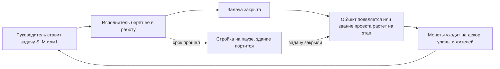

# Пупульта Town: концепция (GDD v0)

> Перенесено из документа на claude.ai 27 октября 2026. Дальше основная версия — этот файл: правки вносятся через pull request.

## Суть

Пупульта Town это таск-трекер, в котором работа видна как живой 3D-городок. Рабочая гипотеза: проекты становятся зданиями, выполненные задачи достраивают их, а по улицам сами ходят жители, ездят машины и летают птицы. Один город общий для всех, кому выдан доступ.

Это пет-проект двух человек без сроков. Первая цель не релиз, а проверка, что таким трекером приятнее пользоваться, чем обычным списком.

Документ — черновик для обсуждения. Мои предложения помечены словом «Рекомендация». Факты помечены метками: \[Certain\] есть источник, \[Likely\] сильный вывод, \[Guessing\] догадка. Всё, что решаете вы, собрано в разделе «Открытые вопросы» в конце.

## Решения от 27 октября

Ваши ответы на открытые вопросы и то, что из них следует. Где решение расходится с текстом ниже, действует решение.

| Вопрос | Решение | Что из этого следует |
| --- | --- | --- |
| Город и проект | один город = один проект; дома = задачи; внутри живут НПС и аватары; у человека может быть несколько городов | меняет вариант В из раздела «Основной цикл». При 100 задачах в проекте выйдет 100 домов. Решено 27 октября: объект зависит от размера задачи. S даёт мелкий объект (ларёк, фонарь, клумба), M даёт дом, L даёт большое здание, которое достраивается по подзадачам. Монеты по-прежнему идут на декор |
| Прогулки аватаром | да, в будущем | сервер сразу закладываем под передачу позиций аватаров в реальном времени, даже если в первой версии прогулок нет |
| Кастомизация | детальная: уникальные здания, много людей, одежды, машин, животных | \[Likely\] для двоих это посильно только через модульные наборы: здание собирается из модулей и цветов, человек из базового тела и сменной одежды на одном скелете. Уникальность дают комбинации, а не отдельные модели |
| Размер города | до 20 человек | нагрузка на реальное время маленькая \[Likely\] |
| Платформа | только компьютер | производительность телефонов не учитываем |
| Два трекера | командный: жёсткие роли, всегда есть руководитель, который раздаёт задачи; личный: «личная комната» персонажа, задачи человек пишет себе сам, их никто не видит и они не просрочиваются | роли в городе: руководитель и исполнители; личная комната принадлежит человеку, а не городу, и одна на все его города (предложение); исполнитель может предложить задачу руководителю, но не в первой версии (решено 27 октября) |
| Просрочки | видимая порча здания сотрудника: грязь, граффити, дефект, ремонт, пожар | 1) порчу вызывают только просроченные командные задачи, личные не просрочиваются (решено); 2) ступени по дням просрочки, пожар последним; 3) закрыл задачу, и приезжает ремонт, прогресс не теряется |
| Рейтинг | неделя, месяц, год и аналитика (постоянный рейтинг убран 27 октября); лучшему сотруднику статуя из его аватара | очки считаются по размеру задачи и сдаче в срок, с дневным потолком; статуя ставится победителю месяца или года в центре города; аналитика входит в трекер |
| Камера | у всех одинаковый стандартный ракурс, поворот разрешён | здания моделируем со всех четырёх сторон |
| 3D | Blender, отвечают оба | общие правила моделей попадут в AGENTS.md и docs на шаге 3 |
| Мудборд | позже, вместе | стиль утверждаем до массового производства ассетов |

## Для кого и зачем

Главный пользователь — один человек с личными задачами. Второй — небольшая команда, которая живёт в одном городе (размер команды вынесен в открытые вопросы).

Основные сценарии:

1. **Утро.** Открываю город и вижу свои задачи на сегодня как стройки у своих зданий. Беру задачу в работу, мой человечек идёт к нужному зданию.
2. **Закрытие задачи.** Здание прирастает на этап, жители реагируют, я получаю монеты.
3. **Общий проект.** У команды одно здание на проект. По стройке видно, кто что сейчас делает.
4. **Вечер.** Захожу и вижу, как город изменился за день из-за работы коллег. Рядом лента событий: кто что закрыл.
5. **Приглашение.** Отправляю ссылку другу, и у него появляется свой дом в моём городе.

&#91;Likely\] Город должен быть наградой и обзором, а не единственным способом вводить задачи. Если для добавления задачи надо кликать по 3D-сцене, трекером перестанут пользоваться через неделю. Рекомендация: быстрая панель со списком задач поверх города и горячие клавиши.

## Основной цикл

Рекомендация: вариант В. Здание проекта растёт от закрытых задач, а монеты за задачи тратятся на декор и жителей. Так по городу сразу видно состояние работы, и остаётся свобода его украшать.

Просроченная задача не ломает построенное, а только ставит стройку на паузу; закрыв её позже, игрок возвращается в обычный цикл.

| Вариант | Как работает | Плюс | Минус |
| --- | --- | --- | --- |
| А. Валюта | задача приносит монеты, игрок сам покупает и ставит здания | свобода, знакомо по играм | город не связан с реальной работой, нужен баланс экономики |
| Б. Проект = здание | здание проекта растёт по мере закрытия его задач | по городу видно состояние работы | меньше свободы игрока |
| В. Гибрид (рекомендую) | основа Б, монеты тратятся на декор, улицы, жителей | город и отражает работу, и даёт поиграть | две системы наград, их надо сбалансировать |
|  |  |  |  |

Завершённый проект остаётся в городе достопримечательностью с табличкой: что сделали и когда.

## Город

Рекомендация: город состоит из трёх типов зон, и он расширяется по мере роста общего уровня.

- **Участок игрока.** Дом каждого участника. Растёт от личных задач, украшается за монеты.
- **Квартал проектов.** Одно здание на каждый проект. Тип здания выбирается при создании проекта (кафе, мастерская, офис).
- **Центр города.** Ратуша с уровнем города, доской достижений и рейтингом. Новый уровень открывает новую улицу или район.

Живость города складывается из пяти слоёв. В первой версии достаточно первых двух–трёх.

| Слой | Примеры | Связь с задачами (предложение) |
| --- | --- | --- |
| Окружение | день и ночь, погода, облака, птицы | время суток по реальным часам; много просрочек, значит пасмурно |
| Жители | прохожие, собаки, продавцы | чисто декор; их становится больше с уровнем города |
| Транспорт | машины, автобус, дирижабль | грузовик привозит материалы, когда задачу взяли в работу |
| Аватары участников | по человечку на каждого | идёт к зданию своей текущей задачи; спит дома, если человек не в сети |
| События | праздник, фейерверк, ярмарка | закрытие этапа или всего проекта |

&#91;Likely\] Главное решение для архитектуры: фоновая жизнь (прохожие, машины, птицы) считается на компьютере каждого игрока и не синхронизируется по сети. По сети идёт только то, что имеет смысл: задачи, здания, статусы аватаров. У двух игроков прохожие будут чуть разные, но этого никто не заметит, а серверная часть станет в разы проще.

## Многопользовательский режим

Рекомендация: город = рабочее пространство, и кооперация важнее соревнования.

- **Доступ.** Владелец города приглашает по ссылке. Роли: руководитель (раздаёт задачи), исполнитель, гость (только смотрит).
- **Личные задачи.** Отдельный личный трекер в «личной комнате» персонажа. Задачи человек пишет себе сам, их видит только он, и они не просрочиваются.
- **Совместные задачи.** Несколько исполнителей, каждый получает полную награду. Делёж награды порождает споры о том, кто сколько сделал \[Guessing\].
- **Реальное время.** Изменения от других появляются за пару секунд без перезагрузки. Ручное управление аватаром и прогулки по городу в первую версию не входят: это уже сетевая игра, другой порядок сложности \[Likely\].

**Рейтинг.** \[Likely\] Рейтинг по числу закрытых задач учит дробить задачи на мелкие и мешает совместной работе: люди начинают играть с метрикой, а не с работой. Рекомендация из трёх уровней:

1. **Уровень города** — главная цифра, общая для всех.
2. **Личные достижения** — серии дней, первый закрытый проект, помощь коллеге.
3. **Недельный рейтинг** — по весу задач с дневным потолком; владелец города может его отключить.

## Трекер задач

Рекомендация: в первой версии трекер минимальный, вся сложность уходит в город.

| Функция | Первая версия | Позже |
| --- | --- | --- |
| Задача: название, описание, срок | да |  |
| Размер задачи S / M / L (определяет награду) | да |  |
| Статусы: нужно сделать, в работе, готово | да | свои статусы |
| Проект как группа задач (= здание) | да |  |
| Несколько исполнителей | да |  |
| Список задач поверх города | да | доска и календарь |
| Лента событий города | да |  |
| Подзадачи, комментарии, вложения |  | да |
| Повторяющиеся задачи и привычки |  | да |
| Уведомления |  | да |
| Импорт из GitHub Issues, Trello и других |  | да |

Просрочки. Рекомендация: мягкие последствия, без разрушения. Стройка замирает, над зданием собирается тучка. \[Guessing\] Потеря построенного чаще заставляет бросить трекер, чем работать быстрее.

Защита от фарма. Награда зависит от размера задачи, а не от их числа, и у неё есть дневной потолок. Точные цифры подберём, когда попробуем сами.

## Визуальный стиль и камера

Три из четырёх референсов — игры с близкой камерой (Schedule I и PEAK прямо описаны как игры от первого лица), а наша камера дальняя, как в Game Dev Tycoon. \[Likely\] Детали, рассчитанные на взгляд вблизи, с расстояния пропадут. Значит, стиль нужно адаптировать, а не копировать.

| Референс | Что это \[Certain, Википедия\] | Что берём (предложение, проверить на скриншотах) |
| --- | --- | --- |
| [Game Dev Tycoon](https://en.wikipedia.org/wiki/Game_Dev_Tycoon) | симулятор бизнеса, Greenheart Games, 2012 | фиксированный взгляд на сцену как на кукольный домик, уют, юмор в мелочах. Сама игра двухмерная \[Likely, в источнике не сказано\] |
| [Schedule I](<https://en.wikipedia.org/wiki/Schedule_I_(video_game)>) | симулятор с открытым миром, TVGS, ранний доступ с 24 марта 2025, от первого лица, есть кооператив | атмосфера небольшого города, здания, улицы, жители |
| [PEAK](<https://en.wikipedia.org/wiki/Peak_(video_game)>) | кооперативный скалолазный симулятор, Aggro Crab и Landfall, 16 июня 2025, от первого лица, до 4 игроков | смешные персонажи, природа, дух игры с друзьями |
| [RV There Yet?](https://en.wikipedia.org/wiki/RV_There_Yet%3F) | кооперативное приключение, Nuggets Entertainment, 21 октября 2025, физика и юмористичная эстетика «dad-core» | транспорт как персонаж, туристический и дорожный вайб |

Рекомендации по стилю и камере:

- **Камера.** Вид сверху под углом, приближение колёсиком, поворот шагами по 90° или без поворота. Свободная камера заставит моделировать здания со всех сторон \[Likely\].
- **Формы.** Крупные силуэты, утрированные пропорции (большая голова у жителей), насыщенные цвета, минимум мелких текстур.
- **Проверка до массового производства.** Сначала мудборд из скриншотов, потом одна тестовая сцена (дом, дерево, машина, три жителя) на настоящем расстоянии камеры. Только после неё рисовать остальное.

## Конвейер ассетов

Рекомендация: договориться о правилах моделей до первой модели. Исправлять масштаб и точки опоры у сотни готовых моделей дороже, чем сразу делать правильно \[Likely\].

- **Формат glTF 2.0 (.glb).** В Blender экспорт встроен: File → Export → glTF 2.0 (.glb, .gltf), вместе с анимациями и скелетом \[Certain, [руководство Blender](https://docs.blender.org/manual/en/latest/addons/scene_gltf2.html)\]. Этот формат понимают все веб-движки, которые мы будем сравнивать в шаге 2 \[Likely\].
- **Масштаб и оси.** В glTF единица длины — метр, ось +Y смотрит вверх \[Certain, [спецификация glTF 2.0](https://registry.khronos.org/glTF/specs/2.0/glTF-2.0.html)\]. В Blender работаем в метрах, человечек примерно 1,7 м.
- **Сетка города.** Одна клетка фиксированного размера (например, 2 × 2 м, цифра подлежит обсуждению). Здания занимают целое число клеток, точка опоры — центр основания.
- **Рост зданий.** Каждое здание делается из этапов: фундамент, леса, этажи, крыша, декор. Модули ставятся друг на друга, а не меняются целиком.
- **Персонажи.** Один общий скелет на всех людей, чтобы анимации ходьбы, работы и радости делались один раз.
- **Материалы.** Одна общая текстура-палитра на весь город. \[Likely\] Мало материалов значит мало вызовов отрисовки, а это главное для сотен жителей в браузере.
- **Автопроверка.** Claude Code напишет скрипт, который проверяет каждый .glb: размер, число полигонов, имена, точку опоры. Бюджет полигонов зададим в шаге 2, после выбора движка.

## Требования для шага 2 (архитектура и стек)

Из концепции следуют требования, по которым мы будем сравнивать варианты стека. Цифры — целевые \[Guessing\], их надо подтвердить.

| Требование | Цель |
| --- | --- |
| Платформа | только браузер на компьютере (решено) |
| Производительность 3D | сотни жителей и машин при 60 кадрах в секунду на обычном ноутбуке |
| Синхронизация | изменения других участников видны менее чем за 2 секунды; в будущем позиции до 20 аватаров в реальном времени |
| Аккаунты | вход, приглашения по ссылке, роли |
| Стоимость | бесплатно или почти бесплатно для пет-проекта |
| Код пишет ИИ | популярные хорошо документированные инструменты, строгая типизация |
| Тесты | модульные, сквозные в браузере и скриншотные для 3D-сцены |

Кандидаты для сравнения (решение не принято): для 3D — Three.js или React Three Fiber, Babylon.js, PlayCanvas, Godot с экспортом в веб; для сервера — Supabase или свой сервер на Node.js с отдельным сервисом реального времени.

## Что не делаем в первой версии

Эти вещи откладываем, потому что каждая из них сама по себе тянет на отдельный проект.

- Ручное управление аватаром и прогулки по городу (архитектуру под них закладываем сразу).
- Чат и голос.
- Мобильное приложение.
- Сложная экономика: торговля, магазины, ресурсы.
- Путешествия между городами (сами города по одному на проект есть сразу).
- Интеграции с другими трекерами.
- Монетизация.

## Открытые вопросы

Ответьте прямо здесь, комментарием или в чате. Первые четыре влияют на архитектуру больше всего.

- [ ] Основной цикл: подходит вариант В (проект = здание, монеты на декор)? \
Согласен с вариантом В
- [ ] Можно ли самому ходить своим человечком по городу в будущем? Если да, архитектуру надо закладывать сразу. Да, идея очень классная, и еще, если мы будем закладывать разные города, то есть как я это вижу, Целый город, это 1 проект, а внутри этого проекта, живут нпс, Люди(аватары) и дома, это задачи. Я хочу, чтобы мы проработали кастомизацию детальную, чтобы каждый проект был уникален, чтобы здания можно было делать уникальными. Богатый набор моделек людей, их одежды, машины, животные, люди и т.д.\

- [ ] Сколько человек максимум в одном городе: до 10 или больше? Может ли человек состоять в нескольких городах? \
\
Максимум 20 человек
- [ ] Платформа: только компьютер или телефон тоже? \
Только компьютер
- [ ] Личные задачи скрыты от команды или видны всем?\
\
Скрыты
- [ ] Просрочки: мягкие последствия или никаких?\
\
Последствия, как я вижу их: Визуальная деградация здания сотрудника, к примеру, пожар, грязь, ремонт, дефект, графити, в таком стиле\

- [ ] Рейтинг: недельный и отключаемый или постоянный?\
\
Рейтинг постоянный, есть недельный, есть месячный, должна быть еще аналитика, и как вариант, большой годовой рейтинг. Как идея, для лучшего сотрудника делать статую из его аватара\

- [ ] Камера: фиксированный угол или поворот?\
\
стандартная камера будет у всех одинаково зафиксирована, но должна быть возможность поворотов \

- [ ] В чём делаете 3D: Blender или что-то другое? Кто из вас двоих отвечает за графику?\
\
В блендере, отвечаем оба, будем дробить и делить задачи \

- [ ] Мудборд: 10–20 скриншотов из референсов с пометкой, что именно берём.\
\
Еще не готово, будем вместе проробатывать и продумывать концепции

## Источники

- [Game Dev Tycoon — Википедия](https://en.wikipedia.org/wiki/Game_Dev_Tycoon)
- [Schedule I — Википедия](<https://en.wikipedia.org/wiki/Schedule_I_(video_game)>)
- [PEAK — Википедия](<https://en.wikipedia.org/wiki/Peak_(video_game)>)
- [RV There Yet? — Википедия](https://en.wikipedia.org/wiki/RV_There_Yet%3F)
- [Спецификация glTF 2.0, Khronos](https://registry.khronos.org/glTF/specs/2.0/glTF-2.0.html)
- [Руководство Blender: glTF 2.0](https://docs.blender.org/manual/en/latest/addons/scene_gltf2.html)
